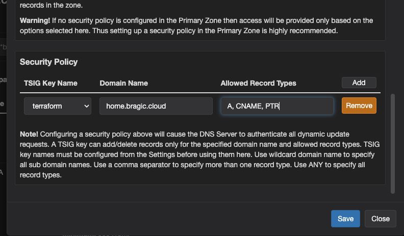
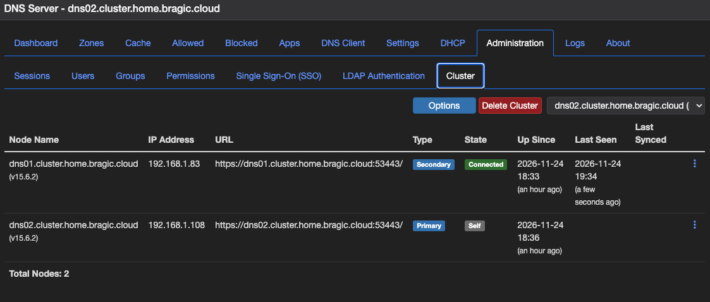
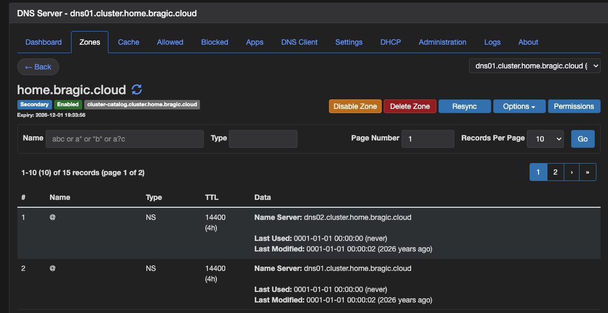
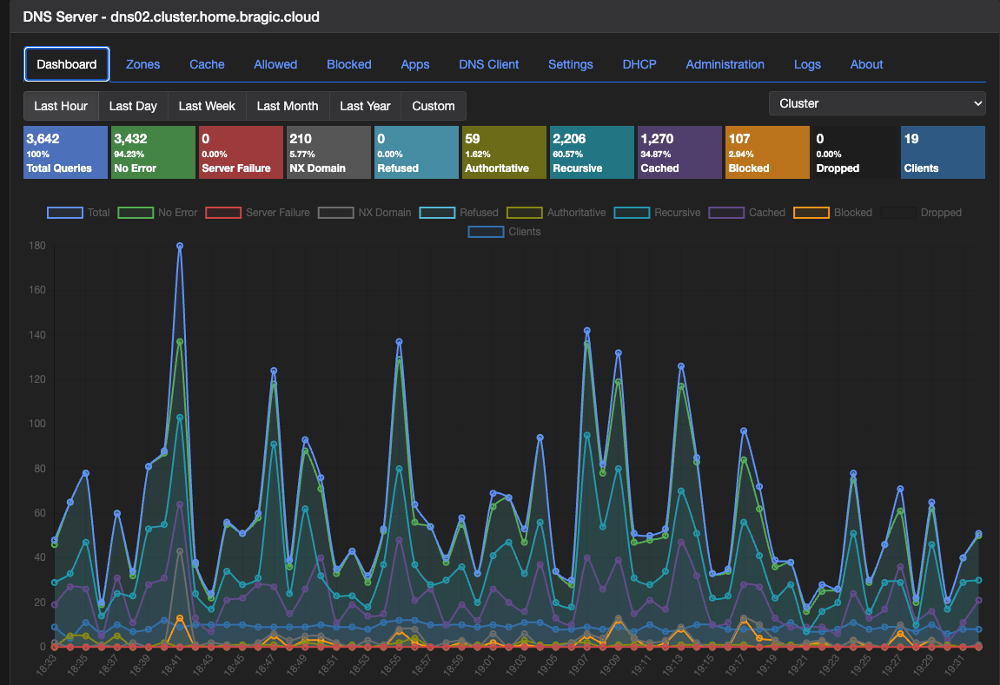

 
In one afternoon and evening, I replaced both of my Pi-holes with Technitium DNS. I set up a two-node cluster and a local zone in Technitium, then used Terraform to manage the DNS records inside that zone. Along the way, a DNSSEC error pointed me at something odd on my own network.
 
Pi-hole served me well. But I kept bumping into its limits. It's a filtering resolver, not a full DNS server. Local records were a flat list, keeping two instances in sync meant running a separate sync container, and there was no clean way to manage any of it as code.
 
Technitium is a full authoritative and recursive DNS server that also does ad blocking. It has real zones, zone transfers, dynamic updates, and, as of v14, native clustering. That combination is what pulled me over.
 
Here's where I ended up:
 
- Two Technitium nodes on two different physical hosts, clustered in Technitium, so either one can go down without taking DNS with it
- Blocking for ads, malware, and adult content, synced across both nodes
- A zone, `home.bragic.cloud`, created in Technitium, with its host and service records managed in Terraform
- A Docker Compose file in Git with per-host settings, used to build the new node
This post walks through how I got there, including the parts that broke.
 
## The starting point
 
I had two Pi-holes, and DHCP handed both of them out to every client:
 
| Host | Role | Where it runs |
| --- | --- | --- |
| lab-docker01 | Primary Pi-hole | Ubuntu Docker host (bare metal) |
| lab-docker02 | Secondary Pi-hole | Debian VM on my Proxmox host |
 
The two lived on different physical machines on purpose. Either box can be rebooted for maintenance without the house losing DNS. A small container, Nebula Sync, kept their settings aligned.
 
My one rule for the migration was *don't disrupt the household*. That shaped the whole plan:
 
1. Migrate the secondary first while the primary carries the load.
2. Stop each Pi-hole rather than delete it, so rollback is one command.
3. Validate every step from a client with `dig`, not by looking at a container that says it's running.
4. DHCP stays on my UniFi Cloud Gateway Ultra. This is a DNS change only.
## Standing up Technitium in Docker
 
I started with the secondary, lab-docker02. Technitium and Pi-hole both want port 53, so I stopped the Pi-hole container, stopped rather than removed. Its restart policy was `unless-stopped`, so it stays down even across reboots, and rollback is just starting it again.
 
Next I checked what else was listening on 53:
 
```bash
sudo ss -tulpn | grep ':53 '
```
 
Only `systemd-resolved` showed up, bound to `127.0.0.53` and `127.0.0.54`. That's systemd's local stub resolver, and it's a common reason a DNS container fails with "address already in use." The tutorial compose I started from published `"53:53/udp"`, which binds every address on the host, loopback included. Instead, I pinned the published ports to the host's LAN IP:
 
```yaml
ports:
  - "192.168.1.108:53:53/udp"
  - "192.168.1.108:53:53/tcp"
  - "192.168.1.108:5380:5380/tcp"   # web UI
```
 
When I checked, my old Pi-hole had been publishing its ports the same way, bound to `192.168.1.108`. That's likely why it had always coexisted with systemd-resolved without me thinking about it.
 
Two other choices I made here:
 
- **A named volume for config**, straight from the tutorial. Docker decides where that data lives. When I later moved the compose file into Git, I switched to a bind mount so the data sits at a path I chose.
- **No admin password in the compose file.** I set it at first login so it never lands in plain text or in Git.
## DNSSEC and a suspicious answer
 
The container came up, and my first test query came back `SERVFAIL` with "Resolver exception." A later attempt gave a more specific error:
 
```
;; ->>HEADER<<- opcode: QUERY, status: SERVFAIL
; OPT=15: ... ("..Attack detected! . DNSKEY IN")
```
 
That's not the error you want to see on a fresh install.
 
Out of the box, Technitium resolves recursively, starting at the root servers, and it validates DNSSEC. The error said it didn't trust what came back when it asked for the root zone's keys. So I tested the path to the root servers myself:
 
```bash
dig @198.41.0.4 example.com
```
 
`198.41.0.4` is a.root-servers.net. A root server doesn't answer `example.com` directly. It refers you to the `.com` servers, and that referral is what I expected. Instead I got a recursive answer: two A records for `example.com`, with the "recursion available" flag set. A query for a made-up name under `example.com` came back `NXDOMAIN` with `example.com`'s own SOA record, which isn't something a root server returns either.
 
That made me suspect something on my network was intercepting plain DNS on port 53 and answering it. The made-up name never showed up in my Pi-hole's query log, so Pi-hole wasn't the one answering. I haven't tracked down what is yet.
 
Rather than chase it in the middle of a migration, I switched Technitium from recursion to forwarders using DNS-over-HTTPS (Cloudflare). DoH travels over port 443, so it doesn't pass through whatever is handling port 53. Resolution started working, and my upstream queries are encrypted now too.
 
## Blocklists
 
I went with three lists, all in formats Technitium reads natively:
 
| List | Covers |
| --- | --- |
| [oisd NSFW](https://nsfw.oisd.nl/domainswild2) | Adult content |
| [HaGeZi Threat Intelligence Feeds](https://github.com/hagezi/dns-blocklists) | Malware, phishing, scams |
| [StevenBlack](https://github.com/StevenBlack/hosts) | Ads and malware, adult content |
 
Technitium answers blocked names with `NXDOMAIN`, so a blocked domain prints nothing with `+short`:
 
```bash
dig @192.168.1.108 doubleclick.net +short
```
 
## DNS records in Terraform
 
I'm familiar with managing infrastructure using Terraform, so I wanted my local DNS records in code too. The split I landed on: the zone and its settings live in Technitium, and Terraform manages the records inside it. A host or service gets a name by adding one line to a map, not by clicking through a UI.
 
### Attempt one: a community provider
 
I started with a community Technitium provider that talks to Technitium's HTTP API. Creating the zone failed:
 
```
Unable to create zone: cannot decode JSON response into the provided structure: EOF
```
 
To rule out the API, I called it directly with `curl`, using the same URL and token. It returned `"status":"ok"`. The API and token were fine, so the failure was somewhere in the provider. I created the zone in the Technitium UI and tried managing just a record with the provider, and that failed with the same EOF error. At that point I stopped debugging it.
 
### Attempt two: a standard protocol
 
So I switched to HashiCorp's official [`hashicorp/dns`](https://registry.terraform.io/providers/hashicorp/dns/latest) provider. It doesn't use Technitium's API at all. It sends standard **RFC 2136 dynamic updates**, signed with a **TSIG** key. That appealed to me: it's a DNS standard rather than one product's API, the same approach works against BIND or Windows DNS, and what I learn doing it carries over to any DNS server that supports the standard.
 
The trade-off is that it manages records only, not zones. That fit my split. I created the zone `home.bragic.cloud` in the Technitium UI, created a TSIG key named `terraform`, and allowed dynamic updates on the zone, restricted to that key.
 
The Terraform is short:
 
```hcl
provider "dns" {
  update {
    server        = "192.168.1.108"
    key_name      = "terraform."
    key_algorithm = "hmac-sha256"
    key_secret    = var.tsig_secret
  }
}
 
locals {
  zone = "home.bragic.cloud."
  hosts = {
    "lab-docker01" = "192.168.1.83"
    "lab-docker02" = "192.168.1.108"
    "lab-pve01"    = "192.168.1.17"
  }
  services = {
    "homepage" = "lab-docker01"
    "uptime"   = "lab-docker01"
    "linkding" = "lab-docker02"
  }
}
 
resource "dns_a_record_set" "hosts" {
  for_each  = local.hosts
  zone      = local.zone
  name      = each.key
  addresses = [each.value]
  ttl       = 300
}
 
resource "dns_cname_record" "services" {
  for_each = local.services
  zone     = local.zone
  name     = each.key
  cname    = "${each.value}.${local.zone}"
  ttl      = 300
}
```
 
Hosts get A records. Services get CNAMEs pointing at their host, so if a host's IP ever changes, I update one line and every service follows. Note the trailing dots: DNS updates use fully qualified names.
 
### The gotcha: REFUSED
 
My first apply was a single test record, `test.home.bragic.cloud`, and it failed:
 
```
Error: Error updating DNS record: 5 (REFUSED)
```
 
Technitium was refusing the update based on the zone's dynamic update policy. The policy screen showed the problem. I'd set the policy's domain to `home.bragic.cloud`, which covers only the zone apex itself, and Terraform was creating a subdomain. The note under the policy table says to use a wildcard for subdomains:
 

 
*The policy as I first set it: the bare zone name, which only covers the apex. The note underneath gives the fix.*
 
```
*.home.bragic.cloud
```
 
I also removed the spaces from the allowed record types (`A,CNAME,PTR`) while I was there. Then `apply` worked. Seeing `dig` return a record that Terraform created was the best moment of the night.
 
Once records were working, I moved Terraform state to a remote backend.
 
## One compose file for both nodes
 
Before building the second node, I put the compose file in my homelab repo. Two DNS servers should be built the same way, and the only things that differ between them are the IP and the name. So those became variables:
 
```yaml
services:
  technitium:
    image: technitium/dns-server:latest
    container_name: technitium
    hostname: ${DNS_HOSTNAME}
    restart: unless-stopped
    ports:
      - "${DNS_IP}:53:53/udp"
      - "${DNS_IP}:53:53/tcp"
      - "${DNS_IP}:5380:5380/tcp"
      - "${DNS_IP}:53443:53443/tcp"
    environment:
      - TZ=America/Los_Angeles
      - DNS_SERVER_DOMAIN=${DNS_HOSTNAME}.home.bragic.cloud
    volumes:
      - ${CONFIG_DIR}:/etc/dns
```
 
Each host gets a small env file committed next to it, like `dns01.env`:
 
```
DNS_IP=192.168.1.83
DNS_HOSTNAME=dns01
CONFIG_DIR=/opt/stacks/technitium/config
```
 
Docker Compose automatically reads a file named `.env` in the project folder. On each host, `.env` is a symlink to that host's file (`ln -s dns01.env .env`). The link is gitignored. A `git pull` updates the real file, and the link follows.
 
The layout separates **code from data**:
 
- `/opt/homelab` holds the Git checkout: compose and env files. I can delete it and re-clone anytime.
- `/opt/stacks/<app>` holds live data. This is what gets backed up, and it's gitignored everywhere.
Before touching anything live, `docker compose config` renders the file with the variables filled in. It's a free check that the IP and hostname are right.
 
lab-docker01 is built from this repo version. lab-docker02 still runs the compose file I started with, and moving it over is on my list. That move includes copying its config out of the named volume and into /opt/stacks/technitium/config.
 
Each host pulls the repo with its own read-only GitHub deploy key. A deploy key is tied to a single repo, so each repo gets its own key and an SSH host alias that points at it:
 
```
Host github-homelab
    HostName github.com
    User git
    IdentityFile ~/.ssh/homelab_docker01
    IdentitiesOnly yes
```
 
Then clone with `git@github-homelab:...`
 
## Clustering instead of a sync tool
 
With Pi-hole, keeping two servers in sync required a separate container (Nebula Sync) copying settings back and forth. Technitium as of v14 has [native clustering](https://blog.technitium.com/2025/11/understanding-clustering-and-how-to.html). One node is primary, the others are secondaries, and settings, blocklists, allowlists, apps, and users sync from the primary automatically. That meant I didn't have to configure the second node by hand.
 
Before touching lab-docker01, I checked that lab-docker02 could carry the house alone: a local name, a public name, and a blocked name, all with `dig` against `192.168.1.108`. I also pulled the Technitium image ahead of time so the cutover wouldn't wait on a download.
 
I also caused my own REFUSED error here. To let dns01 copy the zone, I opened the zone options on dns02 to allow zone transfers to dns01's IP. Zone Options has several tabs that look nearly identical, and I put that ACL on the **Query Access** tab instead of **Zone Transfer**. Public names still resolved, but every lookup in `home.bragic.cloud` from my Mac came back like this:
 
```
;; ->>HEADER<<- opcode: QUERY, status: REFUSED
```
 
Query Access controls who can look up records in the zone, and I'd just limited it to dns01. Setting Query Access back to Allow, with the ACL on the Zone Transfer tab where it belonged, fixed it.
 
The cutover on lab-docker01 went like this:
 
1. Stop Pi-hole and confirm port 53 is free.
2. `docker compose up -d` from the repo checkout.
3. Set the admin password and a DoH forwarder, just enough to serve the house while I finished. My Mac asks this server first, so it couldn't sit broken for long.
4. Publish Technitium's HTTPS port (53443) on both nodes. Cluster traffic between nodes runs over HTTPS with a self-signed certificate.
5. On dns02: **Administration → Cluster → Initialize → New Cluster.**
6. On dns01: **Join Cluster**, pointing at dns02. Joining replaces the joining node's settings with the primary's, which is exactly what I wanted.
7. Add `home.bragic.cloud` to the cluster's **catalog zone**. Zones don't sync automatically. Adding a zone to the catalog makes each secondary create its own copy and keep it current through zone transfers.

 
*Both nodes in the cluster, on the same version.*
 

 
*On dns01, `home.bragic.cloud` shows up as a Secondary zone, tagged with the cluster catalog.*
 
A few decisions worth calling out:
 
- **dns02 is the primary**, because it already had the zone, the TSIG key, and Terraform pointed at it. Terraform still writes only to dns02.
- **The cluster domain is permanent.** I used `cluster.home.bragic.cloud`, a separate subdomain, so the cluster's own zone stays apart from my Terraform-managed zone.
- **Both nodes must run the same Technitium version.** Mine are both on 15.6.2. Pinning the image tag in compose is on my list so upgrades happen together.
The final test was end to end: add a test host in Terraform, `apply` against dns02, then query dns01. dns01 returned the new record.
 

 
*The cluster dashboard about an hour after cutover: 19 clients, no server failures.*
 
## What I learned
 
- **Strict validation can surface problems you didn't know you had.** DNSSEC turned a "why won't this resolve" into a question about my own network.
- **Standard DNS was enough.** Plain RFC 2136 updates signed with TSIG did everything I needed, without a custom provider.
- **Read the policy fine print.** `home.bragic.cloud` and `*.home.bragic.cloud` are not the same thing, and neither are the Query Access and Zone Transfer tabs.
- **Point dig at a specific server.** While two DNS servers are in rotation, run `dig @server` from the client so you know exactly which one answered.
## What's next
 
- Track down what's intercepting plain DNS on port 53.
- Move lab-docker02 onto the repo compose file.
- Set the DHCP search domain to `home.bragic.cloud` so short names like `homepage` work.
- Move the NS records and zone transfer settings into Terraform.
- Put a reverse proxy in front of my services, so they get clean HTTPS URLs with real certificates. Owning the domain makes DNS validation easy.
Pi-hole is still sitting stopped on both hosts. I'll remove it once this setup has run for a while. So far, nobody in the house has noticed the change, which was the whole point.
 